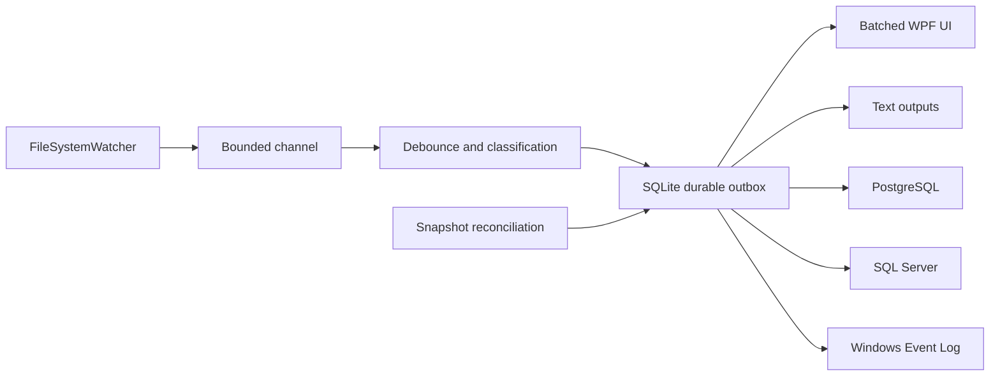

<p align="center">
  
</p>

<h1 align="center">Directory Monitor</h1>

<p align="center">
  A native Windows application for reliable, real-time filesystem monitoring and multi-destination event delivery.
</p>

<p align="center">
  <a href="https://github.com/ntphucc/directory-monitor/actions/workflows/ci.yml"></a>
  <a href="https://github.com/ntphucc/directory-monitor/actions/workflows/codeql.yml"></a>
  
  
  
</p>

Directory Monitor watches multiple local or UNC directories, normalizes filesystem changes, displays them in a responsive WPF interface, and reliably delivers them to one or more configured outputs. A durable SQLite outbox prevents temporary destination failures from blocking monitoring or losing committed events.

## Highlights

- Monitor multiple paths independently, including local folders and UNC shares.
- Track `New`, `Change`, `Modify Properties`, and `Delete` for files, directories, or both.
- Filter entries with include/exclude glob patterns and optionally include subdirectories.
- Deliver concurrently to text files, PostgreSQL, SQL Server, and Windows Application Event Log.
- Recover missed changes through SQLite snapshots and reconciliation after restart, reconnect, resume, or watcher overflow.
- Inspect events in chronological order with color coding, path hyperlinks, filtering, copy actions, and automatic scrolling.
- Run in the system tray, start with Windows, and use localized English/Vietnamese Light, Dark, or System themes.
- Import or export configuration and events as JSON, XML, or password-encrypted `.dm` packages.
- Check and install optional HTTPS updates with size and SHA-256 verification.

## Architecture

The solution follows a layered structure with dependencies pointing inward:



| Project | Responsibility |
|---|---|
| `DirectoryMonitor.Domain` | Entities, enums, and transfer models |
| `DirectoryMonitor.Application` | Use-case interfaces and orchestration contracts |
| `DirectoryMonitor.Infrastructure` | Watchers, SQLite, outputs, updates, security, and import/export |
| `DirectoryMonitor.Presentation` | WPF views, MVVM view models, localization, themes, and app lifecycle |
| `DirectoryMonitor.Tests` | Unit, integration, storage, monitoring, update, and presentation checks |

See [Architecture](docs/ARCHITECTURE.md) for threading, reliability, security boundaries, and project dependency rules.

## Requirements

Runtime targets:

- Windows 10 or Windows 11 x64.
- Windows Server 2022 or 2025 with Desktop Experience.
- Self-contained release builds do not require a separately installed .NET runtime.

Development requirements:

- Windows with the .NET 9 SDK selected by [`global.json`](global.json).
- Visual Studio 2022 or another editor capable of building WPF projects.
- Inno Setup 6 only when producing the Windows installer.

## Build and test

```powershell
dotnet restore DirectoryMonitor.slnx --locked-mode
dotnet build DirectoryMonitor.slnx --configuration Release --no-restore
dotnet test DirectoryMonitor.slnx --configuration Release --no-build --no-restore
dotnet run --project src/DirectoryMonitor.Presentation
```

CI performs the same locked restore, Release build, automated tests, and coverage collection on a Windows runner. CodeQL separately analyzes the C# codebase.

## Storage and configuration

The external `appsettings.json` configures SQLite and Serilog. Relative paths are resolved from the executable directory. The default SQLite location is:

```text
<Directory Monitor.exe folder>\Data\directory-monitor.db
```

For development and tests, `DIRECTORY_MONITOR_DATA` overrides the data directory. SQLite path changes detected while the app is running require a restart so the durable outbox is never split across databases.

Daily UTF-8 operational logs are written to `<app>\Logs` and retained for 30 days by default. Database connection strings are encrypted with Windows DPAPI CurrentUser and are never written to operational logs.

Do not commit local databases, logs, `.dm` exports, certificates, environment files, or customer data. The repository `.gitignore` excludes these common runtime and secret-bearing files.

## Output destinations

| Destination | Behavior |
|---|---|
| Text | UTF-8 Plain Text, JSON Lines, CSV, or custom templates with rotation and retention |
| PostgreSQL 14+ | Automatically creates and migrates tables in the default `public` schema |
| SQL Server 2019+ | Automatically creates and migrates tables in `dbo` |
| Windows Event Log | Writes to `Windows Logs > Application`; the installer registers the event source |

Database delivery is idempotent by event UUID and by `(MachineId, SequenceNumber)`. A destination failure is retried independently and does not block healthy destinations.

## Reliability and security notes

- Watcher callbacks only enqueue raw changes; filesystem, SQLite, network, and UI work run outside the callback and UI threads.
- Events committed to SQLite remain pending until each assigned destination acknowledges delivery.
- The application does not read or store file contents.
- `UserName` identifies the Windows account running Directory Monitor; it does not claim to identify the person or process that changed a file.
- Update manifests and installers must use HTTPS. Installer size and SHA-256 must match the manifest before execution.
- Human-readable JSON/XML exports omit database credentials. Full `.dm` exports use AES-256-GCM with a PBKDF2-derived key.

## Release

```powershell
powershell -ExecutionPolicy Bypass -File scripts/build-release.ps1
```

The release script publishes self-contained `win-x64` files and uses the version in `Directory.Build.props`. Inno Setup 6 is required to create the installer used by automatic updates.

Published releases and notes belong on the [GitHub Releases](https://github.com/ntphucc/directory-monitor/releases) page. Update manifest publishing is documented in [UPDATE_MANIFEST.md](docs/UPDATE_MANIFEST.md).

## Documentation

- [Architecture](docs/ARCHITECTURE.md)
- [Database schema](docs/DATABASE_SCHEMA.md)
- [Operations guide](docs/OPERATIONS.md)
- [Text template tokens](docs/TEXT_TEMPLATE_TOKENS.md)
- [Update manifest](docs/UPDATE_MANIFEST.md)
- [Test report](docs/TEST_REPORT.md)
- [Customer-facing implementation plan](DIRECTORY_MONITOR_PLAN.md)
- [Changelog](CHANGELOG.md)

## Contributing and security

Read [CONTRIBUTING.md](CONTRIBUTING.md) before opening a pull request. Report vulnerabilities privately according to [SECURITY.md](SECURITY.md); never place credentials, connection strings, private paths, or customer data in a public issue.

## License status

No software license has been selected yet. The source is publicly visible, but copyright law applies and no permission to use, modify, or redistribute the software is granted until the repository owner adds a license.
