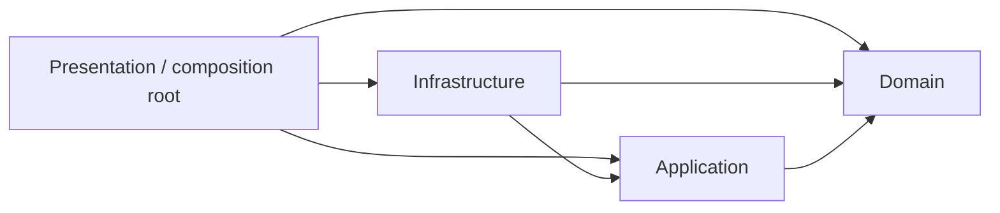
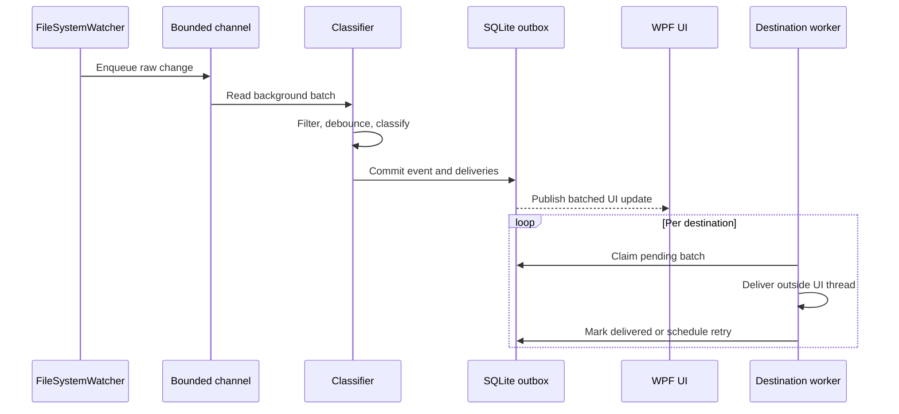

# Architecture

Directory Monitor is a native .NET 9 WPF application designed to keep filesystem observation responsive while destination I/O is slow or temporarily unavailable.

## Dependency direction

- `Domain` contains stable business models and has no dependency on WPF, databases, or operating-system services.
- `Application` defines use-case and infrastructure contracts and depends only on `Domain`.
- `Infrastructure` implements monitoring, persistence, delivery, update, security, and transfer contracts.
- `Presentation` composes the application, owns WPF-specific behavior, and exposes state through MVVM view models.
- `Tests` may reference all projects but production projects must not reference `Tests` or `Presentation` from an inner layer.

## Event pipeline

Watcher callbacks never perform destination, database, or UI I/O. A full bounded channel is treated as an overflow signal and triggers reconciliation instead of blocking a callback indefinitely.

## Durability and recovery

- SQLite stores configuration, machine identity, sequence reservation, snapshots, events, and per-destination delivery state.
- Event and delivery records are committed in one transaction.
- SQLite uses WAL mode and batched prepared operations.
- Each destination has an independent sequential worker and retry state.
- Snapshot reconciliation compares streamed filesystem metadata after startup, resume, reconnect, scheduled scan, or watcher overflow.
- Access-denied paths are not inferred as deletes.
- Imported events are historical data: they create no delivery records and are never replayed.

## UI threading

- Background services communicate through application abstractions rather than directly updating WPF controls.
- UI events are appended in batches to a bounded in-memory collection.
- The Event grid keeps chronological order and trims the oldest rows at the configured buffer limit.
- DataGrid virtualization and batched collection notifications avoid one dispatcher operation per filesystem event.

## Security boundaries

- Database destination credentials are protected with DPAPI CurrentUser at rest.
- Logs intentionally exclude connection strings, passwords, transfer keys, and `.dm` contents.
- JSON/XML transfers omit database credentials.
- `.dm` transfers are encrypted with AES-256-GCM and a PBKDF2-HMAC-SHA256 password-derived key.
- Update downloads require HTTPS, an exact declared size, and an exact SHA-256 digest before execution.
- The installer is the only component expected to request elevation; normal monitoring runs in the selected Windows user's context.

## External systems

PostgreSQL and SQL Server schemas are migrated under destination-specific locks. Windows Event Log source registration occurs during installation. UNC monitoring uses the credentials and network access of the account running Directory Monitor.

Live database, UNC, installer, and sustained-load acceptance tests depend on customer infrastructure and remain separate from the deterministic local suite.
